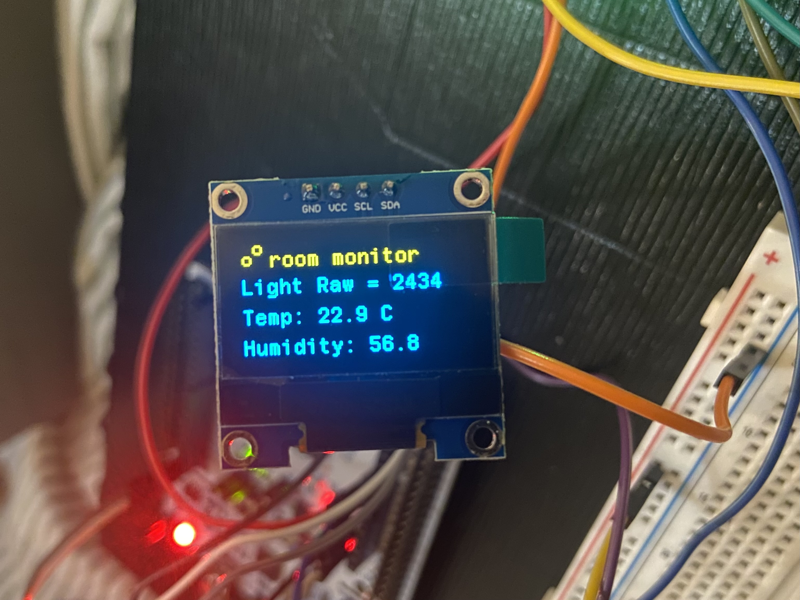
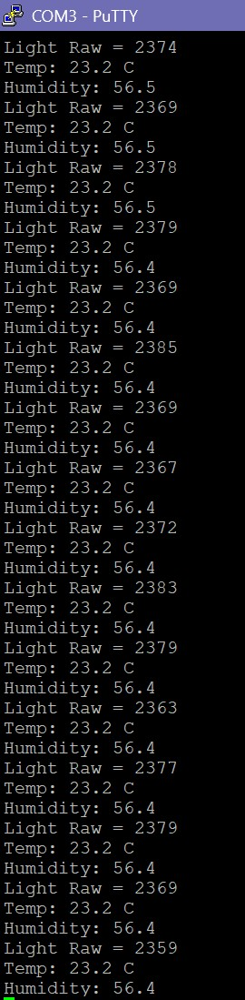
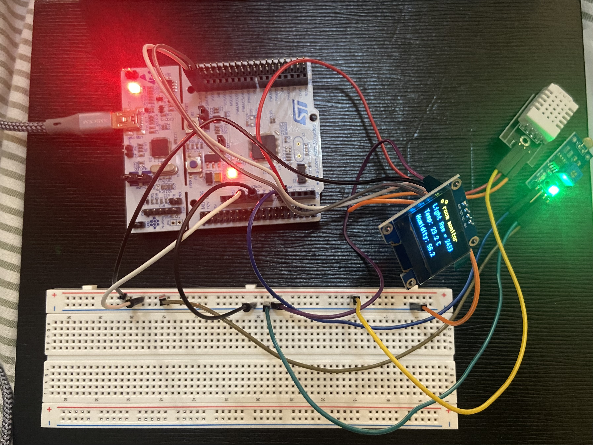

# stm32f4-oled-room-monitor
An embedded room monitoring system built with an **STM32F4 Nucleo board**, featuring a DHT22 temperature/humidity sensor, an ADC ambient light sensor, and an I2C OLED display.

## Project Demo

## Wiring Setup

## 🚀 Features
* **Asynchronous Sensor Polling:** Decouples fast light sensor reads (every 0.5s) from slower DHT22 temperature/humidity reads (every 2s) to prevent blocking the main loop.
* **Live Visual Telemetry:** Renders real-time sensor data and custom graphics onto a 128x64 SSD1306 OLED screen.
* **Debug Logging:** Streams live raw sensor data and timing metrics over the ST-LINK Virtual COM port (`115200` baud).

## 🛠️ Hardware & Components
* **Microcontroller:** STM32F4 Nucleo Board
* **Display:** 0.96" SSD1306 I2C OLED Display
* **Sensors:** DHT22 (Temperature & Humidity), Photoresistor / ADC Light Sensor

## 📂 Project Structure
* `Core/Src/main.c` - Main application logic, timing loops, and sensor handling.
* `Core/Src/` & `Inc/` - Custom drivers and configuration files (including the SSD1306 display driver).
* `Drivers/` - STM32F4 HAL and CMSIS library files.

## 🙏 Credits & Acknowledgments
* OLED display driver integration based on the open-source [afiskon/stm32-ssd1306](https://github.com/afiskon/stm32-ssd1306) library.

